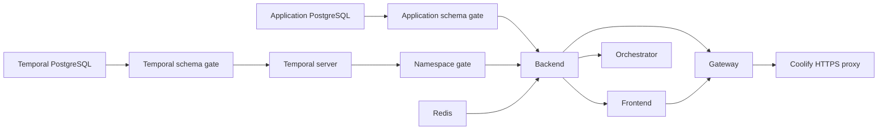

# Creative Social production Compose for Coolify

## GitHub-built application image (4 GB VPS deployment)

The application image is built on a GitHub-hosted runner, not on the Coolify server.
The workflow `.github/workflows/publish-production-image.yml` publishes
`ghcr.io/cgdmohamed/creative-social:<full-main-commit-sha>`.
Its build-time public origin is **https://smm.creativecode.com.eg**. Changing that
origin requires modifying the workflow and rebuilding a new image.

**Release procedure:**

1. Merge reviewed source changes to `main`. In GitHub Actions confirm that
   **Publish Creative Social production image** completed successfully for the exact
   intended commit. The image does not exist until that run succeeds.
2. Confirm the GHCR package can be pulled by the Coolify host. Make the package
   public in GitHub package settings, or configure authenticated registry
   access in Coolify; do not paste GHCR tokens into Docker build arguments.
3. In Coolify keep branch `main`, Compose path `/docker-compose.production.yaml`,
   and gateway 8080. Set `CREATIVE_REVISION` to **the full SHA of the successful
   workflow run**, not a previous sample SHA. Keep `PUBLIC_URL` equal to
   `https://smm.creativecode.com.eg`.
4. **Disable automatic build-variable injection of all runtime environment
   variables.** Only public origin and source revision were build inputs in
   GitHub Actions. Passwords and OAuth tokens remain runtime-only.
5. The application services `frontend`, `backend`, `orchestrator`,
   `app-schema`, and `temporal-namespace` pull the same prebuilt image.
   Small infrastructure images (PostgreSQL wrappers, Redis, Temporal tooling
   and Nginx gateway) are still locally built by Compose.
6. The first empty database boot still requires deliberate one-time initialization
   and all acceptance tests in this guide. This image workflow does **not**
   initialize databases, migrate data, deploy to Coolify, or verify runtime capacity.

Do not attempt deployment on the prior, unpublished commit SHA after switching
the Compose file: it will fail with image-not-found. Existing named volumes must
not be deleted or reassigned as a workaround. The 4 GB VPS may still be
insufficient for the full running stack; off-host builds address build OOM only.


Prepared configuration, **not deployed or runtime-certified**. Use
`docker-compose.production.yaml` with the GHCR-built `Dockerfile.production` application image. This branch builds
Creative Social from this repository and includes the safety fixes in PR #4;
The consolidated release is integrated into main only after local quality gates;
see [RELEASE_ACCEPTANCE.md](RELEASE_ACCEPTANCE.md) for its exact configuration,
additive migration 007, execution enablement and external acceptance checklist.

## What was inspected and replaced

The inherited `docker-compose.yaml` pulls `ghcr.io/gitroomhq/postiz-app:latest`,
contains sample credentials, publishes database-adjacent Temporal/debug ports,
and includes Spotlight, Temporal UI and interactive admin tools. Its
`Dockerfile.dev` runs `pnpm run pm2`, whose startup performs `prisma db push`.
Those files are not the production deployment entrypoint.

The inherited tag-publishing workflow also targets gitroomhq's registry. It is
now guarded to run only in that upstream repository. No tag was created or image
pushed. The new manual **Production image build check (no deployment)** workflow
only builds images, with synthetic secrets, and never starts services or pushes.

Production uses pinned OCI image-index digests, verified through registry
manifest reads on 2026-11-02. Application/gateway/database/Redis/schema-tool images
are built locally from repository Dockerfiles. Temporal's server base is pinned
to the repository's 1.28.1 compatibility baseline; this is not a claim that it is
the latest supported/security-reviewed release. Upgrade/support review remains
an acceptance item. No development server, Elasticsearch, Temporal UI, published
database port, public gRPC port, fixed container name or external shared volume
is required.

## Runtime layout

| Service | Purpose / persistence | Exposure |
| --- | --- | --- |
| gateway | Non-root Nginx; uploads volume read-only | Only public route: internal port 8080 through Coolify HTTPS |
| frontend | Repository-built Next production server | Private 4200; no database/JWT/provider credentials |
| backend | Repository-built Nest API and cron jobs | Private 3000; uploads read/write |
| orchestrator | Repository-built Temporal workers | Private 3002 health endpoint; uploads read/write |
| postgres | PostgreSQL 17 application database | Private data network, named app-postgres volume |
| redis | Authenticated Redis 7.2; AOF/everysec, noeviction | Private data network, named app-redis volume |
| temporal-postgres | PostgreSQL 16, separate history/visibility databases | Private Temporal network, named temporal-postgres volume |
| temporal | temporalio/server 1.28.1, SQL visibility | Private 7233, workflow state stored in Temporal PostgreSQL |
| app-schema | One-time schema readiness / opt-in empty initialization | Private, exits successfully only on zero Prisma drift |
| temporal-schema | One-time pinned-version check / opt-in fresh schemas | Private, no normal-startup schema upgrades |
| temporal-namespace | One-time namespace/search-attribute readiness | Private, creation requires explicit initialization flag |
| temporal-maintenance | Explicit schema upgrade tool, inactive maintenance profile | Private; requires approval argument when invoked |



All long-running services have restart policies, health checks, bounded Docker
logs and graceful-stop time. Schema/namespace jobs use
`service_completed_successfully`; they are deployment gates, not daemons.
Backend/frontend probes are liveness checks. The worker probe checks namespace
reachability, not proof that every provider queue is polling. Docker health checks
alone do not restart an unhealthy process; external monitoring is still required.

The web/data/Temporal networks are internal. Only gateway joins Coolify's managed
default network; app servers get a separate outbound network for official APIs.
There are **no host port mappings**. Use normal managed Compose mode, not Raw mode.

PostgreSQL initializes separate non-superuser runtime owners; admin credentials
are not passed to the API/workers. Redis writes its password to a private runtime
config instead of a command-line argument. Invalid placeholder passwords are
rejected before PostgreSQL initializes PGDATA. Password changes in environment
variables do not rotate roles on an existing database.

## Exact Coolify configuration

These are future operator steps **after release review and deployment approval**.
No corresponding server action was performed while preparing this configuration.

1. In a dedicated Coolify project/environment choose **+ New > Git repository**
   (GitHub App/deploy key or public repository), URL
   `https://github.com/cgdmohamed/creative-social`. Select the approved release
   on main after the image workflow succeeds. Keep automatic/preview deployment
   off during validation; integration into main does not authorize deployment.
2. Under **General > Build pipeline**, choose **Compose**. Set **Base Directory**
   to `/` and **Docker Compose Location** to `/docker-compose.production.yaml`.
   Reload/review parsed content. Do not select the inherited default Compose file,
   Dockerfile.dev, a Postiz registry image, or the staging-only Dockerfile.
3. Under **Advanced > Build**, choose **Build arguments: Managed manually in
   Dockerfile**. The GitHub application-image workflow passes only PUBLIC_URL and
   SOURCE_REVISION. Compose pulls that pinned image. Do not inject runtime credentials
   as build arguments. Keep password/JWT/provider/SMTP values runtime-only.
4. Import the keys from `.env.production.example` into **Environment Variables**.
   Replace every CHANGE_ME value. Generate each of the six secrets independently
   with `openssl rand -hex 32`. Set PUBLIC_URL to the real HTTPS origin without a
   trailing slash, and CREATIVE_REVISION to the full 40-character selected commit.
   Verify that commit in Coolify's deployment source/logs. The image records the
   declared origin/revision and refuses a mismatched runtime configuration.
5. Under **Domains > Add domain**, choose service **gateway**, HTTPS, your host,
   internal port **8080**, path `/`. Older combined-input UIs use
   `https://social.example.com:8080`; the suffix is the container port selector,
   not a public port. PUBLIC_URL remains `https://social.example.com`.
   Enable **Redirect HTTP to HTTPS**. Point the domain's A/AAAA records to the
   Coolify proxy and verify certificate issuance. Do not add domains for any
   database, worker or Temporal service. Do not enable Raw Compose or manually
   publish ports; Coolify generates the normal routing labels/networking.
6. Verify parsed storage: four resource-scoped named volumes for application
   PostgreSQL, Redis, Temporal PostgreSQL and uploads. Keep the resource/volume
   identities stable on redeployment. Do not map these names onto an existing
   installation's volumes without an explicit backed-up migration plan.
7. Choose initialization handling below. Configure optional SMTP/provider keys
   only for the intended accounts. Keep Inbox/Reporting collection flags false
   until real API validation. Leave NOT_SECURED unset.
8. Only after approval, build/deploy the reviewed commit. Inspect each gate's
   exit code and long-running service health, then run the acceptance checks.
   No custom PM2/start command or automatic database-push command is needed.

Coolify references: [Compose from Git, variables, storage, health and builds](https://coolify.io/docs/applications/builds/docker-compose),
[General and per-service HTTPS domains](https://coolify.io/docs/applications/configuration/general).

### First installation: new empty data only

Defaults deny schema or namespace creation. For an approved **new empty** install,
set INITIALIZE_EMPTY_DATABASE, INITIALIZE_EMPTY_TEMPORAL_DATABASES and
INITIALIZE_TEMPORAL_NAMESPACE to `true` for the first deployment. PostgreSQL creates
isolated roles/databases; the app gate creates the full schema built from the exact
Prisma model, Temporal's tools create its two schemas, then the namespace gate
creates the namespace and Text attributes organizationId/postId.

After successful bootstrap, restore all three flags to `false` and redeploy.
They never reset nonempty databases. Application initialization runs under an
advisory lock and an empty-schema assertion in the same SQL transaction as DDL.
Temporal partial initialization fails for manual review; it never deletes tables
or blindly repairs a partially initialized store.

DISABLE_REGISTRATION defaults to true. Create the first administrator only during
an access-restricted bootstrap window: restrict the proxy/domain to administrators,
temporarily set DISABLE_REGISTRATION=false, register the initial account, then
restore true and verify unauthenticated registration is blocked. No default user
or demonstration password is created. Without an email provider accounts activate
automatically; configure external transactional email before inviting clients.

### Existing data: keep initialization flags false

Rehearse restore/upgrade on an isolated copy first. Existing Creative Social data
needs the documented manual additive 001 -> 002 -> 003 upgrades **only if not already
applied**. Run migrations 004–007 only when missing, in order, after a verified database backup. For existing databases, the 007 release migration also transfers ownership of the new advertising tables and enum to the `creative` role, because executing additive SQL as `postgres` alone leaves runtime introspection and DML permissions insufficient. Confirm table ownership and runtime rights before redeploying; never repeat an already committed migration. The app gate checks live datasource versus the compiled Prisma schema
and refuses drift; it never executes `db push`, drops tables, or reapplies old SQL.

A freshly initialized full schema already includes these features: do not apply
001/002/003 afterward. Follow [STAGING.md](STAGING.md) for the existing-database
baseline/upgrade distinctions, backups and ownership diagnostics. No existing
database was accessed or changed during this task.

Temporal history and visibility schemas must match the pinned release. Normal
startup checks versions only. A future approved upgrade uses the inactive
maintenance service with explicit `upgrade --approve-schema-upgrade`, following
release-specific schema order/backups and server compatibility checks. Never
point a different Temporal version at these databases to experiment.

Temporal namespace retention defaults to 30 days for completed workflows. Existing
namespace retention is not changed automatically. NUM_HISTORY_SHARDS is fixed at
64 for this new cluster; changing shard count for existing history is not a normal
environment edit. Do not rename the namespace to recover an existing installation.

Temporal references: [Production server and explicit schema management](https://docs.temporal.io/self-hosted-guide/deployment),
[PostgreSQL advanced visibility](https://docs.temporal.io/self-hosted-guide/visibility),
[pinned 1.28.1 database configuration](https://github.com/temporalio/temporal/blob/v1.28.1/docker/config_template.yaml).

## Storage, secrets and operations

- Application and Temporal database volumes are distinct; workflow history survives
  API/worker replacement. Redis uses AOF/everysec on its volume; persistence is not
  an off-site backup. Uploads are shared by backend/worker and read-only at gateway.
  They are public social-media assets, not private document storage.
- Establish off-site backups and restore tests for both PostgreSQL stores, Redis
  and uploads. Temporal history/visibility should be backed up consistently. Use
  database tools matching PostgreSQL 17 and 16, not an arbitrary older dump client.
- Keep JWT_SECRET stable across image updates: the inherited application also
  uses it for legacy encrypted values. Rotation needs a planned compatibility and
  token/reconnect procedure; replacing the template values on every deploy is wrong.
- Only public URL/revision are build inputs. Real env files, keys and node_modules
  are excluded by the production-specific Docker ignore file, which retains LICENSE,
  source and attribution. Public URL changes require rebuilding Next assets.
- The existing monorepo hoisted dependency tree is retained in the runtime image
  to preserve current module resolution. Compiler OS packages are build-stage only.
  This favors compatibility over a minimal image; dependency-closure reduction and
  image scanning are follow-up release work. Canvas/jsdom/sharp/bcrypt/Temporal
  native imports are probed during both image stages.
- PDF uses local Chromium with its sandbox retained; no no-sandbox fallback is
  enabled. Test non-root Chromium under the actual host's namespace/AppArmor policy.
  JSON/CSV reporting do not require a working browser.
- Start with a host budget around 4 vCPU / 16 GiB and sufficient disk for image
  builds, SQL history, media and backups. These are planning values, not benchmark
  results. Review the configured memory caps under real load. This is a single-host
  layout, not an HA design or a zero-downtime rollout guarantee.
- Some Coolify versions include exited-successful initialization jobs in aggregate
  status. Confirm gate exit code 0 and gateway health. If needed, Coolify documents
  `exclude_from_hc: true` for app-schema, temporal-schema and temporal-namespace.
  That is a Coolify-specific extension, intentionally absent from the portable
  Compose file because plain Docker Compose rejects it. Review parsed/generated
  content and your installed Coolify version before applying that metadata.

## Available validation and acceptance blockers

```sh
docker compose --env-file .env.production.example -f docker-compose.production.yaml config --quiet
docker compose --profile maintenance --env-file .env.production.example -f docker-compose.production.yaml config --quiet
pnpm run lint:deployment
pnpm run test:deployment
pnpm run test:combined
pnpm run build
```

The example intentionally cannot start a real application: startup guards reject
its placeholders. Config validation only resolves it; it does not deploy anything.
Deployment tests use synthetic values, mocked Temporal RPC boundaries and ephemeral
PGlite to verify fail-closed settings, empty-only transactional initialization,
namespace gates, build sources, private networks and secret separation.

See [PRODUCTION_VALIDATION.md](PRODUCTION_VALIDATION.md) for actual executed checks.
Before production acceptance, still verify Linux image builds, startup/restarts,
database backup/restore and drift, Redis auth/leases, Temporal namespace/pollers,
HTTPS login/cookies/uploads/WebSockets, two-organization authorization, and PDF
rendering on an isolated instance. Confirm image support/CVE status and capacity.

Real Meta App Review/OAuth scopes, comments/DM windows, quota and metric responses
remain unvalidated. Collection flags remain disabled. Meta Ads / Google Ads are
still data models/contracts, not live collectors. WordPress credentials are per
connected integration, not a required separate WordPress container. The existing
128-error/1,102-warning P2 lint backlog remains in the pre-staging audit.

Provide users the corresponding source for the exact running revision under AGPL,
including modifications. No server deployment, volume cleanup, database mutation,
main update, image publication or production infrastructure action was performed.
